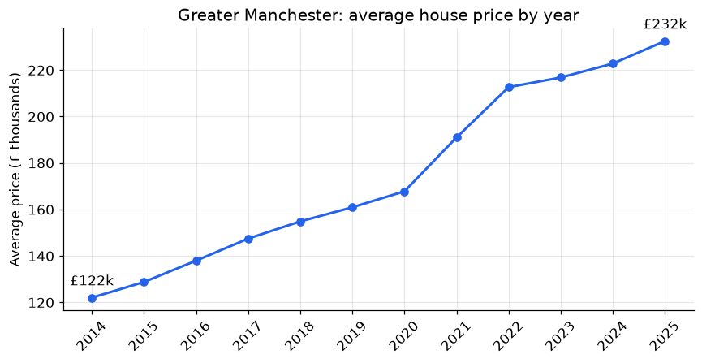
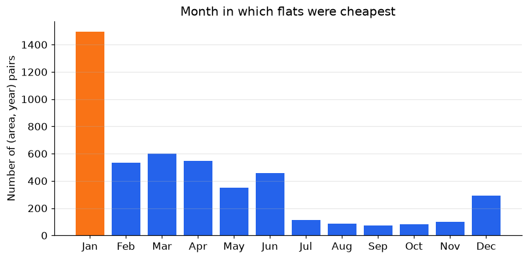
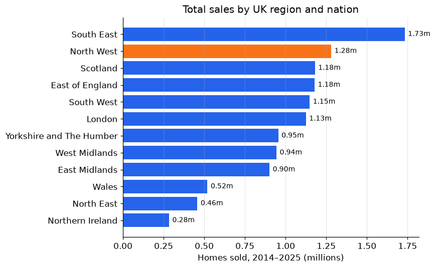
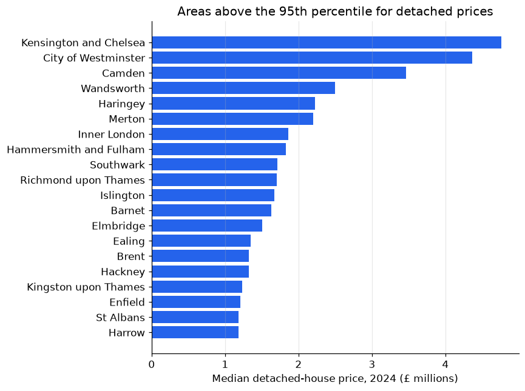

# UK House Prices 2014–2025

**Since January 2015, Greater Manchester house prices have risen 90%, compared with 54% for the UK and only 28% for London. Four Greater Manchester boroughs are among the ten fastest-growing areas in the country.**

**[▶ Open the notebook](uk_house_prices.ipynb)** · [← All projects](../)

---

## The problem

The [UK House Price Index](https://www.gov.uk/government/publications/about-the-uk-house-price-index/about-the-uk-house-price-index) publishes monthly average prices and sales volumes for 405 areas, from whole nations down to local councils, in **58,320 rows**. I wanted to know:

1. Can the data be trusted? Do the sales figures add up?
2. How has Greater Manchester's market moved, and how does it compare with the rest of the UK?
3. Which areas are the most expensive, and where does Greater Manchester rank?
4. Is there a month when flats are reliably cheapest?

## Approach

| Step | What I did | Why |
|---|---|---|
| **Validate** | Checked that new + existing sales = total sales on every row | Catch data errors before drawing conclusions |
| **Clean** | Removed national aggregates and incomplete rows | The `Region` column mixes nations, regions, counties and councils, and mixing levels double-counts |
| **Aggregate** | Group-by summaries of sales volume, annual prices and 2024 medians | Turn 58k monthly rows into comparable area-level figures |
| **Index** | Rescaled each area's price so Jan 2015 = 100 (a House Price Index) | Raw £ changes favour expensive areas. An index compares *growth* fairly |
| **Test a hypothesis** | For each area-year, found the month with the lowest flat price | Check the "buy in winter" folk wisdom with data |

## Results

| Finding | Evidence |
|---|---|
| **The data is reliable** | 99.9% of rows are consistent. The 75 exceptions cluster in 5 areas, including the North and West Northamptonshire councils created in 2021 |
| **Greater Manchester nearly doubled** | Average price went from £122k (2014) to £232k (2025), with a 14% jump in 2021 alone |
| **The North West outpaced London** | Salford, Oldham, Manchester and Rochdale are all in the UK top 10 for growth since 2015 |
| **Expensive homes are a London story** | 17 of the 20 areas above the 95th percentile for detached prices are London boroughs. Greater Manchester sits at about the 40th percentile |
| **January is the cheapest month for flats** | It wins in 32% of area-years against 8% by chance, partly because prices rise through the year |

<table>
<tr>
<td></td>
<td></td>
</tr>
<tr>
<td></td>
<td></td>
</tr>
</table>

## Skills this project shows

- **Data validation:** an accounting identity used as an automatic quality check
- **pandas:** filtering, `groupby` aggregation, quantiles, date handling, `map`-based joins
- **Analytical judgement:** spotting mixed geographic levels and naming the trend effect behind the "cheapest month" result
- **Communication:** findings written for a non-technical reader, with one chart per question

## Data

UK House Price Index, HM Land Registry, published under the [Open Government Licence v3.0](https://www.nationalarchives.gov.uk/doc/open-government-licence/version/3/). The file is in [`data/`](data/).
