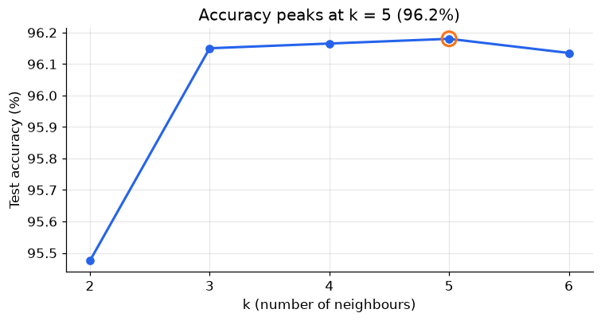
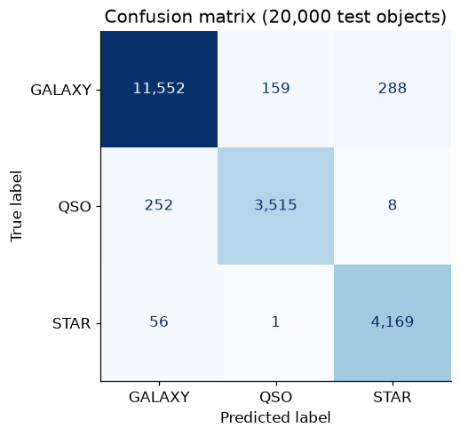

# k-Nearest Neighbours from First Principles

**A from-scratch k-NN implementation, validated against scikit-learn, and a pipeline that labels 100,000 Sloan Digital Sky Survey objects as galaxies, stars or quasars with 96.2% accuracy.**

**[▶ Open the notebook](knn_star_classification.ipynb)** · [← All projects](../)

---

## The problem

Telescopes record far more objects than astronomers can label by hand. Given only an object's brightness in five colour bands (`u g r i z`) and its **redshift**, can a model tell whether it is a **galaxy**, a **star** inside our own galaxy, or a distant **quasar**?

Before using a library, I built the method myself to understand what it can and can't do.

## Approach

| Part | What I did | Why |
|---|---|---|
| **1. Theory** | Derived the lowest possible training error under L1 loss: when the same input has different labels, the best prediction is their coordinate-wise **median** | Shows there is an irreducible error floor, and that zero training error means memorisation, not skill |
| **2. Build** | Wrote k-NN in plain Python/NumPy with a custom mixed-exponent distance and deterministic tie-breaking (closest neighbour wins tied votes) | Custom metrics matter when features differ in meaning, and reproducible tie-breaking matters in production |
| **3. Validate** | Compared my neighbour search with scikit-learn's `NearestNeighbors` using the same metric | **Identical results on 100/100 random queries** |
| **4. Apply** | scikit-learn pipeline (z-score scaling + k-NN) on 100k SDSS objects, choosing k on a 20% hold-out | A leak-free pipeline: the scaler only ever sees training data |

## Results

<table>
<tr>
<td></td>
<td></td>
</tr>
</table>

| | Precision | Recall |
|---|---:|---:|
| Galaxy | 97.4% | 96.3% |
| Quasar | 95.6% | 93.1% |
| Star | 93.4% | 98.7% |
| **Overall accuracy** | | **96.2%** (baseline: 59%) |

- **Redshift does most of the work.** Stars sit at redshift ≈ 0, galaxies mostly below 1, and quasars reach 2 to 7.
- **Quasars are hardest:** 252 of the 260 missed quasars were labelled galaxies, where the two classes' redshifts overlap.
- **Preprocessing beats tuning.** Standardising features cuts the error rate from 5.0% to 3.8%, while any k from 3 to 6 performs within 0.05 points.

**Next steps:** compare with gradient-boosted trees, and choose k by cross-validation rather than a single split.

## Skills this project shows

- **Mathematical reasoning:** deriving the optimal predictor under L1 loss (median), and finding and fixing a subtle bug in an earlier first-match version
- **Algorithm implementation:** custom distance metrics, sorting with explicit tie-break rules, majority voting
- **Testing:** unit-style checks of edge cases, plus cross-validation of the implementation against a reference library
- **Applied ML:** scikit-learn pipelines, feature scaling, hyperparameter selection, confusion-matrix error analysis

## Data

[Stellar Classification Dataset – SDSS17](https://www.kaggle.com/datasets/fedesoriano/stellar-classification-dataset-sdss17) (fedesoriano, Kaggle), derived from the Sloan Digital Sky Survey Data Release 17. The file is in [`data/`](data/).
