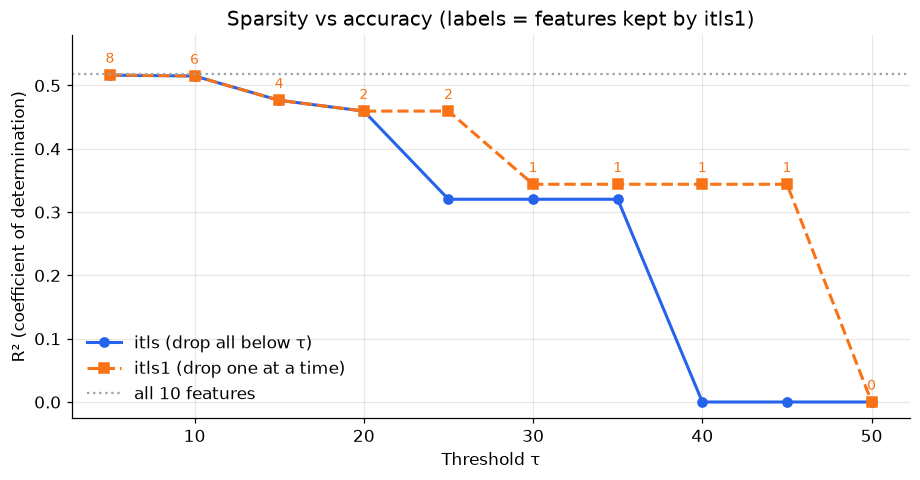
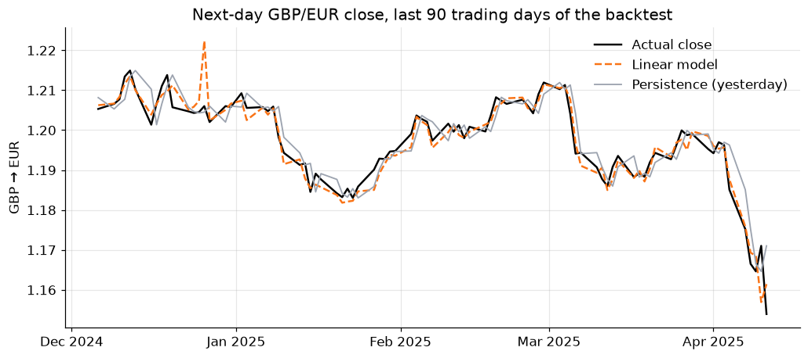

# Sparse Regression, Text Classification and FX Forecasting

**Three short ML problems, three lessons: few features can carry most of the signal; judge classifiers on held-out data with a proper probabilistic score; and when a forecast beats the market by 44%, check the timestamps.**

**[▶ Open the notebook](regression_text_forecasting.ipynb)** · [← All projects](../)

---

## 1 · Sparse regression by iterative thresholding

**Question:** which of 10 clinical measurements actually predict diabetes progression?

I implemented **iterative-thresholding least squares** in NumPy in two variants. One drops *all* weak features at once (`itls`); the other drops them *one at a time*, refitting after each removal (`itls1`).

- **BMI and `s5` (a blood-serum triglyceride measure) alone reach R² = 0.46**, which is 89% of the full 10-feature model's 0.52.
- **Refitting after each removal is more robust.** At τ = 25, one-shot thresholding discards `s5` together with weaker features and drops to R² = 0.32. The one-at-a-time version keeps it.
- **Spotted a modelling issue:** as specified, the model has no intercept, so every R² came out *negative* (−3.4). Centring the target fixed it.

## 2 · Classifying forum posts into 20 topics

**Question:** given word counts from a post, output a probability for each of 20 newsgroup topics.

| Model | Train acc. | **Test acc.** | **Test log loss** |
|---|---:|---:|---:|
| k-NN on scaled counts (first approach) | 66% | 28% | 16.8 |
| TF-IDF + logistic regression | 83% | **55%** | **1.5** |

- The first model's 66% *training* accuracy hid a **28% held-out accuracy**. Its log loss was even worse than a uniform guess, because k-NN gives exactly 0 probability to topics with no neighbour among the 5.
- Switching to **TF-IDF weighting + logistic regression** on the same 500 features roughly doubled accuracy and cut log loss elevenfold.

## 3 · Forecasting tomorrow's exchange rates

**Question:** predict next-day Open, High, Low and Close for GBP/EUR and GBP/USD.

I trained one linear regression per target on the previous day's values, then ran a **walk-forward backtest** over 334 unseen trading days (Jan 2024 to Apr 2025) against the standard **persistence** baseline (tomorrow = today).

| | EUR Close | EUR High | EUR Low | USD Close | USD High | USD Low |
|---|---:|---:|---:|---:|---:|---:|
| Improvement over persistence | **+44%** | +12% | −20% | **+45%** | +14% | +1% |

**A 44% edge on a major currency pair is a red flag, not a result.** The fitted model predicts tomorrow's close mainly from *today's High and Low*, and on 22% of days the recorded Open exactly equals the Close. Both point to the "Close" being **a snapshot taken early in the trading day**. The model exploits that timing quirk rather than predicting the market.

## Skills this project shows

- **Numerical methods:** least squares, iterative feature elimination, R² computed from first principles
- **NLP:** bag-of-words, TF-IDF, probabilistic multi-class classification, log-loss evaluation
- **Time series:** leak-free walk-forward backtesting against a naive baseline
- **Scepticism:** diagnosing a missing intercept, overfit training scores and a data-timing artefact, three different ways a metric can mislead

## Data

- **Diabetes:** Efron et al. (2004), bundled with scikit-learn (`load_diabetes`)
- **20 Newsgroups:** bundled with scikit-learn (`fetch_20newsgroups`), downloaded on first run
- **Exchange rates:** daily GBP/EUR and GBP/USD, Sept 2003 to Apr 2025, in [`data/`](data/)
