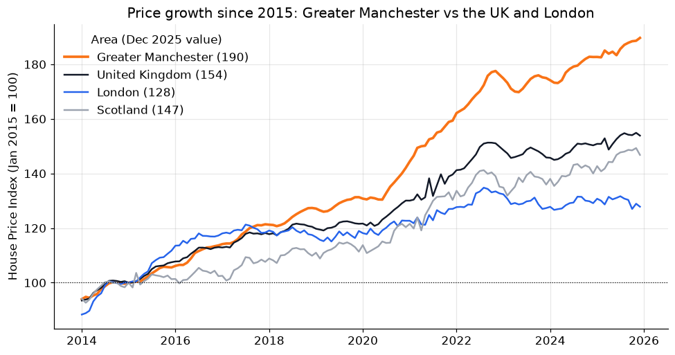
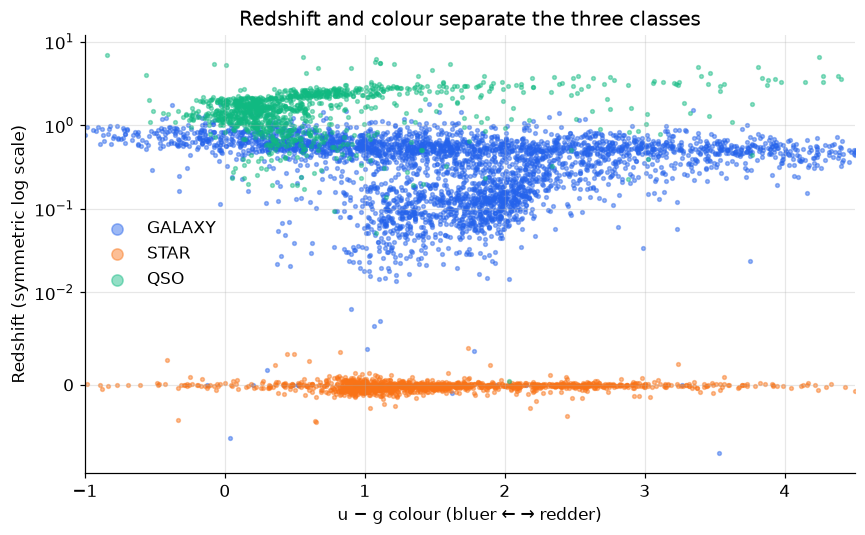
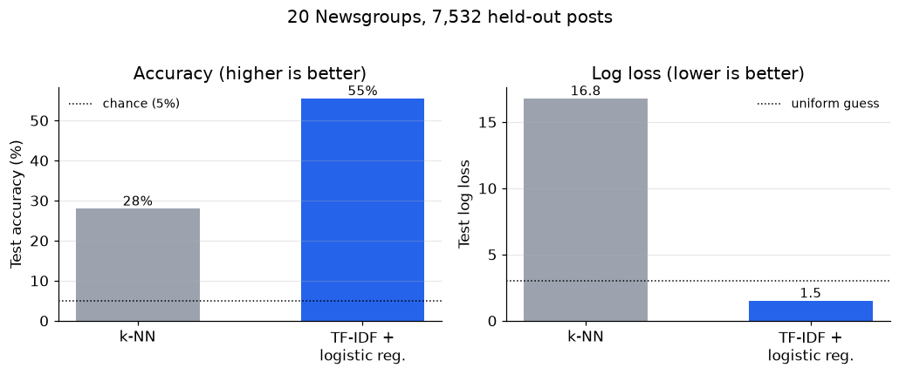

# Machine Learning Case Studies (Python)

**Three applied projects that go from raw data to findings: 12 years of UK house prices, a k-NN classifier built from scratch that labels 100,000 sky objects with 96% accuracy, and a forecasting backtest whose "too good to be true" result I traced to a flaw in the data.**

Coursework for a third-year machine learning module, University of Manchester, 2025/26. Each project is a self-contained Jupyter notebook with its data, charts and a short write-up.

<table>
<tr>
<td width="33%" valign="top">
<a href="01-uk-house-prices/"></a>
<h3><a href="01-uk-house-prices/">1 · UK House Prices</a></h3>
Since 2015, Greater Manchester prices rose <b>+90%</b>, against +54% for the UK and +28% for London.<br><br>
<i>pandas · data cleaning · validation · index construction</i>
</td>
<td width="33%" valign="top">
<a href="02-knn-star-classification/"></a>
<h3><a href="02-knn-star-classification/">2 · k-NN from Scratch</a></h3>
Classifies galaxies, stars and quasars with <b>96.2% accuracy</b>. The custom implementation matches scikit-learn on 100/100 tests.<br><br>
<i>NumPy · algorithm design · scikit-learn pipelines</i>
</td>
<td width="33%" valign="top">
<a href="03-regression-text-forecasting/"></a>
<h3><a href="03-regression-text-forecasting/">3 · Regression, Text & FX</a></h3>
Sparse regression from scratch. Text-classifier accuracy <b>doubled</b> (28% → 55%). A 44% FX "edge" exposed as a timestamp artefact.<br><br>
<i>feature selection · NLP · time-series backtesting</i>
</td>
</tr>
</table>

---

## Projects at a glance

| # | Project | Question | Key result | Notebook |
|---|---|---|---|---|
| 1 | [**UK House Prices 2014–2025**](01-uk-house-prices/) | Where are prices growing fastest, and is there a cheapest month to buy? | GM +90% since 2015; four GM boroughs in the UK's top 10 for growth; January is cheapest in 32% of area-years | [open](01-uk-house-prices/uk_house_prices.ipynb) |
| 2 | [**k-NN from First Principles**](02-knn-star-classification/) | Can a nearest-neighbour model tell galaxies, stars and quasars apart? | 96.2% test accuracy on 20,000 objects; z-scoring removes a quarter of errors | [open](02-knn-star-classification/knn_star_classification.ipynb) |
| 3 | [**Sparse Regression, Text & FX Forecasting**](03-regression-text-forecasting/) | Which features matter? Which topic is a post about? Can tomorrow's FX rate be predicted? | 2 of 10 features keep 89% of R²; text accuracy 28% → 55%; FX edge traced to data timing | [open](03-regression-text-forecasting/regression_text_forecasting.ipynb) |

## Skills these projects show

- **Data wrangling and quality checks:** consistency checks, handling mixed geographic levels, missing-value strategy (pandas)
- **Algorithms from scratch:** k-nearest neighbours with a custom metric and deterministic tie-breaking, iterative-thresholding least squares (NumPy), each validated against a reference
- **Modelling:** scikit-learn pipelines, standardisation, hyperparameter selection, logistic regression, TF-IDF text features, linear forecasting
- **Honest evaluation:** held-out test sets, probabilistic scoring (log loss), confusion matrices, walk-forward backtests against a naive baseline
- **Critical thinking:** questioning results that look too good, and explaining *why* a model works or fails
- **Communication:** every project ends with plain-English findings and clear charts

## Run it yourself

```bash
git clone https://github.com/raudhahabas/machine-learning-case-studies.git
cd machine-learning-case-studies
python -m venv .venv && source .venv/bin/activate
pip install -r requirements.txt
jupyter notebook
```

All datasets are included in each project's `data/` folder. The diabetes and 20 Newsgroups datasets come from scikit-learn, and 20 Newsgroups downloads automatically (about 14 MB) the first time project 3 runs.

## Repository layout

```
01-uk-house-prices/
  uk_house_prices.ipynb            analysis notebook
  data/UK_houseprices2026.csv      UK House Price Index, 2014–2025
  figures/                         charts used in the README
02-knn-star-classification/
  knn_star_classification.ipynb
  data/star_classification.csv     SDSS DR17, 100,000 objects
  figures/
03-regression-text-forecasting/
  regression_text_forecasting.ipynb
  data/gbp-eur2.csv, gbp-usd2.csv  daily exchange rates, 2003–2025
  figures/
requirements.txt
```

## Author

**Siti Raudhah Abas** · BSc Mathematics, University of Manchester
